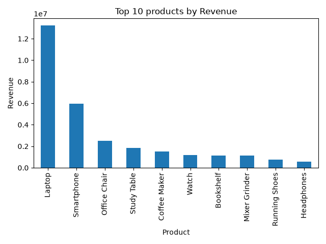
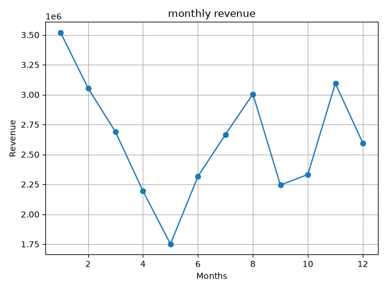

# E-Commerce Sales & Customer Analysis

## 📌 Project Overview

This project focuses on analyzing e-commerce sales data to understand sales performance, customer behavior, product performance, and monthly revenue trends.

The project combines **SQL and Python** for data analysis.

SQL is used for database-level analysis, while Python is used for data cleaning, statistical analysis, and visualization.

---

## 🎯 Project Objectives

- Analyze overall e-commerce sales performance
- Identify top-performing products
- Analyze revenue across different cities
- Compare category-level performance
- Identify high-value customers
- Analyze discount patterns
- Analyze order status distribution
- Study monthly revenue trends
- Extract useful business insights from the data

---

## 📂 Dataset

The dataset contains **1,505 records** and **14 columns**.

### Columns

| Column | Description |
|---|---|
| `order_id` | Order identifier |
| `order_date` | Date of the order |
| `customer_id` | Customer identifier |
| `customer_name` | Customer name |
| `city` | Customer city |
| `state` | Customer state |
| `product` | Product purchased |
| `category` | Product category |
| `quantity` | Quantity purchased |
| `unit_price` | Price of one unit |
| `discount` | Discount percentage |
| `payment_method` | Payment method used |
| `order_status` | Order status |
| `rating` | Customer rating |

> The dataset is synthetic and created for educational and portfolio purposes.

---

## 🛠️ Tools & Technologies

- Python
- Pandas
- NumPy
- Matplotlib
- MySQL
- SQL
- Git
- GitHub

---

## 📁 Project Structure

```text
E-Commerce-Sales-Customer-Analysis/
│
├── data/
│   └── ecommerce_sales.csv
│
├── sql/
│   └── ecommerce_analysis.sql
│
├── visualizations/
│   ├── top_products.png
│   └── monthly_revenue.png
│
├── ecommerce_analysis.py
├── README.md
└── requirements.txt
```

---

# 🔎 Data Analysis

## 1. SQL Analysis

MySQL was used to perform business-oriented analysis on the dataset.

The analysis includes:

- Total number of unique orders
- Number of unique customers
- Total quantity sold
- Top 5 products by revenue
- Revenue by city
- Average order revenue by category
- Top 10 customers by spending
- Products with average discount above 10%
- Number of orders by order status
- Cities with completed-order revenue above ₹5,00,000

---

## 2. Python Data Cleaning

Pandas was used to prepare the dataset for analysis.

The following steps were performed:

- Loaded the CSV dataset
- Checked missing values
- Checked duplicate records
- Converted `order_date` to datetime format
- Removed duplicate records
- Handled missing discount values
- Handled missing rating values
- Verified that the cleaned dataset contained no missing values

---

## 3. Revenue Analysis

Revenue was calculated using:

```text
Revenue = Quantity × Unit Price
```

Discounted revenue was calculated using:

```text
Discounted Revenue = Revenue × (1 - Discount / 100)
```

---

## 4. Category Analysis

The project analyzes each product category based on:

- Total revenue
- Average rating
- Average order revenue

This helps identify which categories contribute most to overall business performance.

---

## 5. Monthly Revenue Analysis

The order date was used to extract the month.

Monthly revenue was calculated to identify:

- Highest revenue month
- Lowest revenue month
- Revenue fluctuations throughout the year

A line chart was created to visualize the monthly revenue trend.

---

# 📊 Visualizations

## Top 10 Products by Revenue



**Observation:**  
Laptop generated the highest revenue among all products, followed by Smartphone and Office Chair.

## Monthly Revenue



**Observation:**  
January recorded the highest monthly revenue, while May recorded the lowest monthly revenue.

---

# 💡 Key Business Insights

### 1. Product Performance

Laptop was the highest revenue-generating product with approximately **₹1.32 crore** in revenue.

### 2. Smartphone Performance

Smartphone was the second-highest revenue-generating product with approximately **₹59.6 lakh** in revenue.

### 3. City Performance

Ahmedabad generated the highest total revenue among the cities, with approximately **₹41.85 lakh**.

Hyderabad ranked fifth in total revenue with approximately **₹31.80 lakh**.

### 4. Category Performance

Electronics had the highest average order revenue among the analyzed categories.

Fashion had the lowest average order revenue.

### 5. Customer Spending

Customer **C207** was the highest-spending customer with approximately **₹6.87 lakh** in total spending.

### 6. Discount Analysis

No product had an average discount greater than **10%**.

Jeans had the highest average discount at approximately **8.98%**.

### 7. Order Status

The dataset contains three major order statuses:

- Completed
- Returned
- Cancelled

Completed orders represent the largest portion of the orders.

### 8. Monthly Revenue

January had the highest monthly revenue at approximately **₹35.19 lakh**.

May had the lowest monthly revenue at approximately **₹17.51 lakh**.

### 9. Revenue Distribution

The average order revenue was approximately **₹20,974**, while the median was approximately **₹7,249**.

Since the mean is significantly higher than the median, the revenue distribution is **right-skewed**.

---

# 📈 Statistical Analysis

NumPy was used to calculate important statistical measures for order revenue.

| Measure | Value |
|---|---:|
| Mean | ₹20,974.02 |
| Median | ₹7,249.07 |
| Minimum | ₹760.13 |
| Maximum | ₹2,88,293.15 |
| Standard Deviation | ₹40,483.55 |

### Statistical Interpretation

- The mean revenue was approximately ₹20,974.
- The median revenue was approximately ₹7,249.
- The mean being significantly higher than the median indicates a right-skewed revenue distribution.
- The high standard deviation indicates substantial variation in order revenue.
- A smaller number of high-value orders significantly increase the overall average revenue.

---

# 🧹 Data Cleaning

The dataset initially contained:

- **5 duplicate records**
- **6 missing discount values**
- **6 missing rating values**

The following data-cleaning steps were performed:

1. Loaded the dataset using Pandas.
2. Checked the dataset for missing values.
3. Identified duplicate records.
4. Converted `order_date` into datetime format.
5. Removed duplicate records.
6. Filled missing discount values using the mean discount.
7. Filled missing rating values using the mean rating.
8. Verified the cleaned dataset.

After cleaning, the dataset contained **1,500 records** with no missing values.

---

# 📊 SQL Business Analysis Results

### Top 5 Products by Revenue

| Rank | Product | Revenue |
|---|---|---:|
| 1 | Laptop | ₹1,32,19,630.64 |
| 2 | Smartphone | ₹59,60,311.90 |
| 3 | Office Chair | ₹25,17,777.25 |
| 4 | Study Table | ₹18,23,301.23 |
| 5 | Coffee Maker | ₹15,03,470.52 |

### Revenue by City

| Rank | City | Revenue |
|---|---|---:|
| 1 | Ahmedabad | ₹41,84,893.12 |
| 2 | Jaipur | ₹36,47,416.38 |
| 3 | Mumbai | ₹36,15,461.53 |
| 4 | Kolkata | ₹33,98,425.75 |
| 5 | Hyderabad | ₹31,80,494.96 |
| 6 | Chennai | ₹28,42,574.83 |
| 7 | Delhi | ₹28,37,977.81 |
| 8 | Bangalore | ₹26,53,045.11 |
| 9 | Kochi | ₹26,10,935.19 |
| 10 | Pune | ₹25,11,540.55 |

### Top 10 Customers by Spending

| Customer ID | Customer | Total Spending |
|---|---|---:|
| C207 | Kiran | ₹6,87,140.41 |
| C270 | Nikhil | ₹6,42,882.65 |
| C239 | Pooja | ₹6,39,273.84 |
| C195 | Neha | ₹5,43,982.57 |
| C264 | Pooja | ₹5,33,236.10 |
| C220 | Sanjay | ₹4,65,278.46 |
| C300 | Sanjay | ₹4,36,216.51 |
| C226 | Vikram | ₹4,33,505.14 |
| C151 | Neha | ₹4,18,659.60 |
| C252 | Rohit | ₹4,08,022.52 |

---

# 📅 Monthly Revenue

| Month | Revenue |
|---|---:|
| January | ₹35,19,374.82 |
| February | ₹30,54,885.33 |
| March | ₹26,87,805.46 |
| April | ₹21,93,829.93 |
| May | ₹17,50,576.03 |
| June | ₹23,16,852.94 |
| July | ₹26,66,258.50 |
| August | ₹30,04,827.36 |
| September | ₹22,44,474.66 |
| October | ₹23,32,492.72 |
| November | ₹30,93,922.74 |
| December | ₹25,95,736.60 |

**Highest Revenue Month:** January — ₹35,19,374.82

**Lowest Revenue Month:** May — ₹17,50,576.03

---

# 🚀 Future Improvements

The project can be further improved by:

- Building an interactive Power BI dashboard
- Performing customer segmentation
- Analyzing repeat customers
- Analyzing returned and cancelled orders in more detail
- Studying customer lifetime value
- Performing advanced SQL analysis
- Creating more interactive visualizations
- Adding predictive sales analysis
- Building a sales forecasting model
- Analyzing customer purchasing patterns
- Identifying high-value customer segments
- Comparing payment methods and their contribution to revenue

---

# ▶️ How to Run the Project

## 1. Clone the Repository

```bash
git clone <your-github-repository-url>
```

## 2. Open the Project Folder

```bash
cd E-Commerce-Sales-Customer-Analysis
```

## 3. Install Python Dependencies

```bash
pip install -r requirements.txt
```

## 4. Run the Python Analysis

```bash
python ecommerce_analysis.py
```

## 5. Run the SQL Analysis

Open MySQL and execute the SQL queries available in:

```text
sql/ecommerce_analysis.sql
```

---

# 📌 Project Highlights

- Performed SQL-based business analysis
- Cleaned and processed data using Pandas
- Used NumPy for statistical analysis
- Created visualizations using Matplotlib
- Identified top-performing products
- Identified high-value customers
- Analyzed city-level revenue
- Analyzed category-level performance
- Analyzed discount patterns
- Analyzed order status distribution
- Analyzed monthly revenue trends
- Identified revenue distribution patterns
- Extracted actionable business insights

---

## 👩‍💻 Author

**Girija**

Third-Year Computer Science Engineering Student
